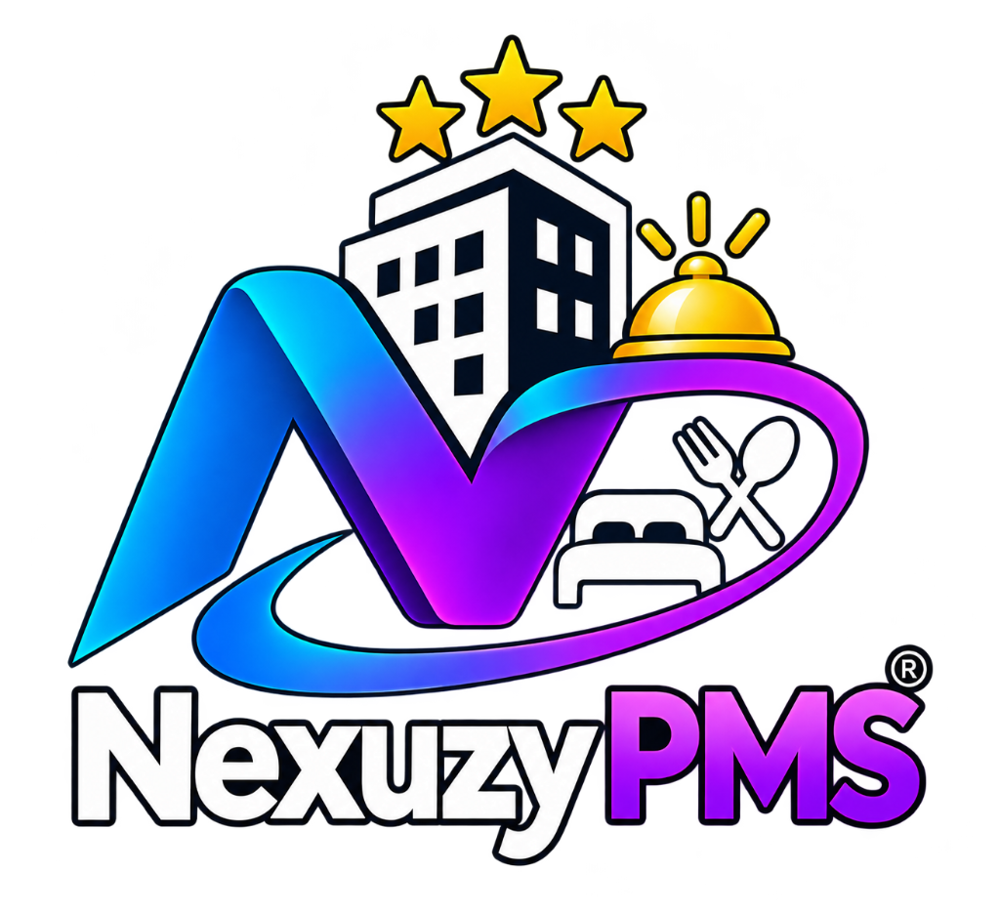

# Nexuzy PMS

<p align="center">
  
</p>

<h3 align="center">Hotel, Restaurant, Bar, Front Desk, Billing & Property Operations Management System</h3>

<p align="center">
  <strong>Developed by Nexuzy Lab</strong><br>
  Lead Developer & Maintainer: <strong>David</strong> (<a href="mailto:david@nexuzy.in">david@nexuzy.in</a>)<br>
  Website: <a href="https://nexuzy.in">https://nexuzy.in</a> &middot; 
  Support Maintenance: <a href="https://razorpay.me/@nexuzylab">razorpay.me/@nexuzylab</a><br>
  License: <strong>MIT</strong>
</p>

---

## 🌟 Key Features

- **No Demo Data Required (Clean Production Mode)**: The automated **1st-Time Setup Wizard** creates the local database and asks for Hotel Name, Address, Contact, GSTIN (optional), hotel logo (optional), Bank details (Bank, A/C #, IFSC, Branch), UPI ID, Room/Restaurant GST tax rates, and Master Admin credentials.
- **Official Branding**: Built-in Nexuzy PMS vector logo & favicon across headers, login and printable invoices. Every booking bill, checkout invoice, restaurant bill and PDF also carries the hotel's own uploaded logo and a **“Generated by Nexuzy PMS · Nexuzy Lab”** footer, stamped on every page of multi-page PDFs.
- **Cross-Platform One-Click Install**:
  - **Windows**: `install.bat` and `start.bat`
  - **Linux & macOS**: `install.sh` and `start.sh`
  - **Docker**: `docker compose up -d`
  - **Linux Daemon**: `deploy/nexuzy-pms.service` (systemd)
- **Native app window**: `start.bat`, `start.sh` and the desktop shortcut open Nexuzy PMS in its own Chromium app window (Chrome, Edge, Brave or Chromium) without a browser address bar. An already-running local server is reused, and the default browser is used only as a fallback.
- **Portable `.nxp` Backup & Restore**: Export your entire hotel database into a verified, checksum-protected **`.nxp`** file and restore it on any other computer (Windows, macOS, Linux) with a single click.
- **Google Drive Cloud Backup**: Automated offsite cloud backups to your designated Google Drive folder.
- **SMTP Mail System**: Integrated `nodemailer` support for Gmail, Outlook, Amazon SES, or custom cPanel mail with a built-in "Send Test Email" diagnostic tool.
- **Room & Rate Management**: Create and edit room types, floors, buildings, occupancy limits, GST and room inventory from **Rooms & HK → Manage Rooms & Types**.
- **Restaurant Menu Management**: Create menu categories and dishes, set prices, GST, kitchen/bar/bakery station, veg/non-veg and availability from **Restaurant POS → Manage Menu**.
- **Staff User Management**: Add staff logins, assign roles, deactivate staff and reset passwords from **Settings → Staff Users & Access**.
- **Printable GST Invoices & Bills**: A4 PDF tax invoices and restaurant bills are generated server-side with property GSTIN, HSN/SAC, tax breakup, bank/UPI details and balance due.
- **Group Staggered Check-In & Check-Out (PRD Section 7)**: Independent room schedules under one master group booking. Check in only arriving rooms; check out departed rooms while others remain occupied.
- **Restaurant POS & Room Service (PRD Section 11 & 34)**: Table floor plan, 5% F&B GST, live Kitchen Display System (KDS), separate restaurant bills, and **Post to Room** folio charging.
- **Financial correctness (v1.1.0)**: Advance ledger and receipts, confirmation conditions, guest folio, checkout bill preview and staff confirmation, locked final invoice, exactly-once restaurant room posting and separate-payment reconciliation. Every money action is audited and duplicate submissions are rejected with idempotency keys.
- **Local network mode (v1.2.0)**: Off by default. When enabled, staff devices on the same private Wi-Fi use the host's live database with individual accounts, per-device sessions and immediate revocation, a copyable URL/QR code and a configurable port (default target 5000). Settings includes a live connection test and firewall check. On Windows, run **`enable-lan-firewall.bat`** once as Administrator if phones cannot connect. See [docs/LAN_SETUP.md](docs/LAN_SETUP.md).
- **Hotel branding & WhatsApp bills**: Upload the hotel's own logo during first-time setup or later in **Settings**; large images are automatically resized to 1024 px and converted to a PDF-safe format. It is used in the app header, favicon, on-screen bills and every server-generated PDF, alongside the Nexuzy PMS application branding. Booking bills, checkout bills and restaurant bills can be downloaded as PDF and shared to the guest's WhatsApp with a pre-filled message carrying the same booking/bill number. The PDF downloads first so staff attach it in WhatsApp Web.
- **Hotel expense ledger & profit**: Record salaries, groceries, utilities, maintenance and other operating costs with category, vendor, payment mode (cash, UPI, card, bank, net banking, credit) and period totals. Voiding keeps the record for audit. The dashboard shows today's expenses and net (collections − expenses), and **Reports → Profit & Loss** shows revenue excluding GST, taxes, expense categories, monthly profit and margin for any date range.
- **Restaurant advance table bookings**: Take an advance (cash, UPI, bank transfer, net banking or card), choose the table and slot, and the booking is confirmed automatically with a receipt. Seat, complete, cancel, refund with approval, and share the confirmation on WhatsApp.
- **Booking changes & extensions**: Cancel, reschedule dates and extend individual bookings or in-house stays, with revised confirmation documents, price-difference review and audit records.
- **Desktop app shortcut**: The installers and first-time setup create a one-click launcher that starts the local server and opens the app window (Windows `.lnk` via a hidden-console VBS launcher, Linux `.desktop`, macOS `.app`). Recreate it any time from **Settings → Desktop Shortcut**.
- **About, support and updates**: **Settings → About, Support & Uninstall** shows the Nexuzy Lab developer details, website, GitHub repository, donation link/UPI and the running version. Installed builds check GitHub for a newer release once a day (administrators can check immediately), show a release banner, download the correct installer for the current platform, verify its published SHA-256 when available, and start the update. Uninstalling is administrator-only, requires typing `UNINSTALL`, and keeps hotel data.
- **Release engineering (v1.1.0)**: Semver `package.json`, changelog, SHA-256 checksums, clean allow-list release packages and GitHub Actions CI/release workflows. See [CHANGELOG.md](CHANGELOG.md).

---

## 🌐 Website & illustrated field guide

The marketing homepage and complete illustrated user guide are static HTML/CSS/JS files under [`public/website/`](public/website/). No build step is required. With the PMS running, open:

- **Homepage:** [http://localhost:5000/website/](http://localhost:5000/website/)
- **Field guide:** [http://localhost:5000/website/docs.html](http://localhost:5000/website/docs.html)

The guide covers installation, first-run setup, front desk, reservations, rooms and housekeeping, restaurant POS, GST invoices, expenses, reports, backups, LAN mode, updates, uninstall and troubleshooting. It uses the real Nexuzy PMS logo and 17 annotated screenshots, and can be printed or saved as a PDF.

---

## 🚀 Easy Installation Guide

### Recommended: Windows installer (no Node.js needed)

Download or build **`dist/installer/Nexuzy-PMS-Setup-<version>.exe`** and double-click it. It installs for the current Windows user under `%LOCALAPPDATA%\Programs\Nexuzy PMS`, carries its own Node.js runtime, production dependencies and frontend assets, and creates **Desktop** and **Start Menu** shortcuts. The hotel PC needs no Node.js, npm, administrator rights or internet connection; Tailwind CSS is bundled locally so setup, login and billing work offline.

Build it on 64-bit Windows with Inno Setup 6 installed:

```bash
npm run build:installer
```

The EXE and its SHA-256 file are written to `dist/installer/`. Upgrades preserve `data\` (database, uploaded logos, backups), and uninstalling leaves hotel data in place. The installer uses the hotel's `nexuzy.ico` for Setup, shortcuts and the uninstall entry. See [installer/README.md](installer/README.md).

### Linux installer (no Node.js needed)

Use `dist/installer/Nexuzy-PMS-<version>-linux-x64.run` (self-extracting) or the matching `.tar.gz`. Both bundle Node.js and SQLite for 64-bit glibc Linux:

```bash
chmod +x Nexuzy-PMS-1.2.0-linux-x64.run
./Nexuzy-PMS-1.2.0-linux-x64.run
```

It installs to `~/.local/share/nexuzy-pms`, creates application-menu and desktop shortcuts, and preserves hotel data on upgrade and uninstall. Remove it from **Settings → About, Support & Uninstall** or by running the installed `uninstall.sh`.

### macOS installer (no Node.js needed)

Use `dist/installer/Nexuzy-PMS-<version>-macos-arm64.tar.gz` on Apple Silicon or `...-macos-x64.tar.gz` on Intel. Extract the archive and double-click **Install Nexuzy PMS.command**; the app is copied to `~/Applications` with a Desktop shortcut. Data lives in `~/Library/Application Support/Nexuzy PMS` and is kept on uninstall. Remove the app from **Settings → About, Support & Uninstall**. The app is unsigned, so right-click → Open on first launch if Gatekeeper blocks it.

### All platforms in one ZIP (GitHub release upload)

After building the installers, create one upload-ready bundle:

```bash
npm run build:installers
npm run package:installers
```

The bundle is written to:

```
dist/installer/Nexuzy-PMS-<version>-all-platforms.zip
dist/installer/Nexuzy-PMS-<version>-all-platforms.zip.sha256
```

It contains the Windows Setup EXE, Linux `.run` and `.tar.gz`, both macOS
archives, their `.sha256` files, `SHA256SUMS.txt` and `INSTALL.txt`. Upload the
ZIP and its `.sha256` file to a GitHub release. The in-app updater expects the
individual platform asset names, so also attach the five installer files from
`dist/installer/` to the same release if you want automatic updates to find
them.

Pushing a `v*` tag runs `.github/workflows/release.yml`, which builds the
Windows installer on Windows, the Linux/macOS packages on Ubuntu, creates this
combined ZIP, and publishes the ZIP, source package and individual installer
assets automatically.

### Clean release workspace

Generated output is ignored by Git. A clean release workspace keeps:

```
dist/installer/Nexuzy-PMS-<version>-all-platforms.zip
dist/installer/Nexuzy-PMS-<version>-all-platforms.zip.sha256
dist/nexuzy-pms-v<version>.zip
dist/nexuzy-pms-v<version>.zip.sha256
```

`installer/build/`, `installer/build-cross/`, `installer/vendor/` and the
individual installer files in `dist/installer/` are generated and can be
removed after the bundle is made; `npm run build:installers` recreates them.

`data/` (the live hotel database), `backups/` and
`dist/original-data-backup-*` are operational data, not release files. They are
excluded from both release archives and should be kept when cleaning build
output.

### Windows (from source)
1. Double-click **`install.bat`** (installs dependencies, prepares storage and creates the desktop app shortcut).
2. Double-click the **Nexuzy PMS** desktop shortcut, or **`start.bat`**, to start the server and open the app in its own window. On first launch the setup wizard creates the database and asks for the hotel name, address, logo, GST/bank details and admin login.

### Linux & macOS
1. Open terminal and run:
   ```bash
   chmod +x install.sh start.sh
   ./install.sh
   ./start.sh
   ```
2. Run **`./start.sh`** or the desktop shortcut to open the app in its own window. On first launch the setup wizard creates the database and hotel/admin profile.

The app window needs Chrome, Edge, Brave or Chromium installed; without one, Nexuzy PMS opens in your default browser instead.

If port **5000** is already occupied — for example by a source checkout or another PMS installation — the desktop app automatically tries ports **5001–5009** and opens on the first free one. This keeps separate installations usable without stopping the other server. The actual port is written to `data/runtime.json` and logged in `data/launcher.log`.

### Docker (Any OS)
```bash
docker compose up -d
```
Open **[http://localhost:5000](http://localhost:5000)** and complete the first-run setup wizard.

### Port and LAN access

The server uses port **5000** by default and listens on the host's private
interfaces. LAN access stays disabled until an administrator enables it in
**Settings & Backup → Local Network**. Plain HTTP on a private network is
unencrypted; never forward the port from a router. Full instructions, firewall
rules, device setup and migration steps: [docs/LAN_SETUP.md](docs/LAN_SETUP.md).

---

## 🔄 About, support and uninstall

Open **Settings & Backup → About, Support & Uninstall** for developer details,
the GitHub repository, the donation link and the installed version. Administrators
also see the update controls and the uninstall action. The update check runs once
a day in installed builds; it never blocks offline hotel operations.

Optional environment variables:

- `NEXUZY_DONATION_URL` — donation page, default `https://razorpay.me/@nexuzylab`.
- `NEXUZY_DONATION_UPI` — optional UPI ID shown with a copy button.
- `GITHUB_TOKEN` (or `NEXUZY_GITHUB_TOKEN`) — optional read-only token for GitHub
  API rate limits or private release repositories.

Uninstall removes program files only. Windows keeps `data\` in the install
folder; Linux keeps the install folder's `data/`; macOS keeps data in
`~/Library/Application Support/Nexuzy PMS`. Take a backup before uninstalling.

---

## ✅ Verification and release builds

```bash
npm run migrate          # apply additive, idempotent schema upgrades
npm run lint             # syntax check
npm test                 # legacy + P0 financial/LAN + management/PDF suites
npm run release:package  # build dist/nexuzy-pms-v<version>.zip + SHA-256
npm run verify           # tag/version, forbidden files, syntax and artefact checks
```

Release packages contain application code only: no `.env`, `data/`,
`backups/`, uploaded documents, databases or `node_modules`. Existing data stays
in `data/` and survives upgrades. Requirement coverage and remaining gaps are
recorded in [docs/GAP_ANALYSIS.md](docs/GAP_ANALYSIS.md).

---

## ⚙️ 1st-Time Setup vs. Demo Seed

1. **Clean Production Mode (Recommended)**:
   - When launching on a fresh install, the **1st-Time Setup Wizard** automatically opens.
   - Enter your Hotel Name, Phone, Address, GSTIN (optional), Bank account, IFSC, UPI ID, and Administrator credentials.
   - Click **Launch Property** — your hotel is now active with zero dummy data!

2. **Demo Mode (For Evaluation & Testing)**:
   - To populate demo data (*Grand Nexuzy Hotel & Suites* with rooms, menu, in-house stays, and group offsite):
     ```bash
     npm run seed
     ```
   - Default demo password for all staff accounts: `admin123`

---

## 💾 Backups, Portable `.nxp` & Google Drive

- **Export `.nxp` Package**: Go to **Settings & Backup** ➔ click **Export & Download .nxp Package**. Saves a complete verified snapshot.
- **Restore on Another Computer**: Open Nexuzy PMS on your new machine ➔ **Settings & Backup** ➔ select the `.nxp` file ➔ click **Upload & Restore Database**.
- **Google Drive Sync**: Enter your Google Drive Folder ID under **Settings & Backup** ➔ click **Sync to Google Drive Now**.

---

## 🧪 Automated Testing

Execute the comprehensive 14-test suite validating reservation double-booking prevention, staggered group operations, room-service folio posting, GST calculations, and night audit:
```bash
npm test
```

---

## 🛡️ License & Contributing

Nexuzy PMS is open-source software licensed under the [MIT License](LICENSE).
Contributions and bug reports are welcome via [GitHub Pull Requests](CONTRIBUTING.md).
